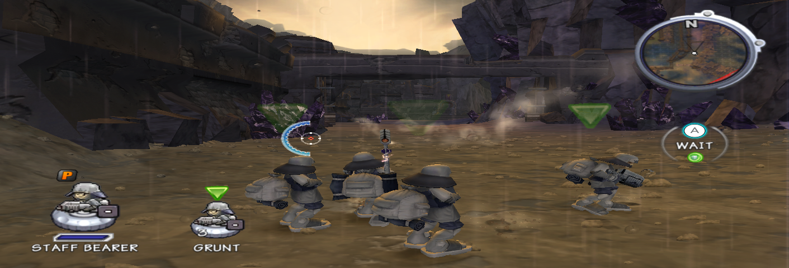

# Frontline 2 Recomp

A native port of Battalion Wars 2 (Wii, 2007) made with static recompilation:
the PowerPC code of the game's `main.dol` is translated to C++ ahead of time and
linked with a runtime that stands in for the Wii hardware and SDK. There is no
emulator, no interpreter and no JIT; nothing executes PowerPC at runtime.

It is a fork of [WiiCompiled](https://github.com/patchzyy/Wiicompiled), the
Mario Kart Wii recompilation, retargeted to one disc of a different game. See
[`ORIGIN.md`](ORIGIN.md) for what was taken from where.

> [!IMPORTANT]
> This repository contains no game code, no translated code and no game data.
> You need your own legally dumped copy of the game (**RBWE01**, the NTSC-U disc,
> revision 0). The translation and the compilation run on your machine against
> your disc, and nothing is uploaded anywhere.

**Status: 0.1.0, early.** macOS on Apple Silicon only. The campaign's first
mission plays from start to victory with keyboard and mouse; the second mission
loads and plays; nothing beyond that has been checked. Rendering is at the
console's 640×480 and 30 fps. Full list in [`CHANGELOG.md`](CHANGELOG.md).



## What works

| Area | 0.1.0 |
| --- | --- |
| Platform | Native arm64 binary for macOS 14+ (Apple Silicon); graphics through [Aurora](https://github.com/encounter/aurora) on Dawn/Metal |
| Game | Boot, intro video, title screen, saves (in an emulated NAND), name entry, main menu, campaign prologue and **mission 1 to victory**: tutorial, heavy tank, gunboats, battlestation, gate chains, magazines, tower, autosave and the campaign cinematic. Mission 2 loads and plays |
| Graphics | Terrain with textures, skinned units, sky, water, HUD, minimap, cinematics, 2D menus and text. Zero decode desyncs over a full mission |
| Audio | Music, voice lines and sound effects (AI/AX/DSP high-level emulation) |
| Input | Keyboard and mouse emulate a Wii Remote + Nunchuk, including the IR pointer and lock-on |
| Translation | 23 897 functions translated from `main.dol` with a reproducible function map; 0 unsupported instructions |

## What does not work yet

- Only mission 1 is verified. The rest of the campaign, skirmish and multiplayer
  are untested. Nintendo WFC is off.
- Internal resolution is the console's 640×480; no scaling, aspect-ratio or
  resolution options yet (next version).
- No gamepad, no relative mouse, no key remapping, no HOME menu.
- The upstream WiiCompiled features in the settings overlay (frame
  interpolation, high internal resolution, music ducking) have not been
  validated with this game.
- macOS only. A browser build (WebAssembly + WebGPU) and a PS Vita build are the
  plan after resolution and controls, not before.

## Controls

The game is played as on the Wii, with the mouse as the pointer:

| Wii | Keyboard / mouse |
| --- | --- |
| IR pointer | Mouse |
| A / B | Left click / right click |
| Nunchuk stick | W A S D |
| D-pad | Arrow keys |
| + / − | Enter / Backspace |
| Z / C | Space / Left Shift |
| 1 / 2 | 1 / 2 |
| HOME | H (menu not implemented yet) |

F10 opens the settings overlay.

## Building and running

Everything is built on your machine. From a clean clone on an M4 Mac with 10
cores the whole pipeline (function map, translator, translation of 23 897
functions, configure and C++ compilation) took about 4 minutes, plus the time
to copy the disc. Slower machines will take longer. You need:

- An Apple Silicon Mac with macOS 14 or later and the Xcode Command Line Tools
  (`xcode-select --install`) for `clang`.
- [.NET 8 SDK](https://dotnet.microsoft.com/download/dotnet/8.0) (the translator
  is C#).
- [CMake](https://cmake.org/download/) 3.25 or newer and
  [Ninja](https://ninja-build.org/) (`python3 -m pip install --user ninja` works).
- Python 3.10 or newer (the function map).
- Your RBWE01 disc, either as an image (ISO, RVZ, WBFS, WIA, CISO, GCZ) or as a
  folder extracted with Dolphin or [nodtool](https://github.com/encounter/nod)
  (`sys/` and `files/` inside).

Then:

```sh
git clone https://github.com/<org>/frontline2-recomp.git
cd frontline2-recomp
./build.sh "/path/to/your/RBWE01.rvz"      # or the extracted folder
```

`build.sh` checks the `main.dol` hash (any other disc or region is rejected),
extracts the image if needed (it downloads a pinned, checksummed
[nodtool](https://github.com/encounter/nod) release for that), installs the game
files into the app's data folder, generates the function map, builds the
translator, translates `main.dol`, generates the build graph and compiles the
runtime. It ends by writing `dvd_root` into the configuration file. Logs of every
step land in `build-macos/*.log`.

Run the game with:

```sh
build-macos/FrontlineRecomp
```

Configuration, saves and logs live in
`~/Library/Application Support/FrontlineRecomp/` (`Config.toml`, `NAND/`,
`Logs/`). The binary and that folder keep the earlier working name
`FrontlineRecomp` in the 0.1.x series so existing saves stay where they are.

Rebuild after changing the runtime only: `./build.sh --skip-translate`. The
developer loop after changing the translator or the address tables is
`projects/bw2/tools/iterate.sh`.

## How it is made

- **Translator** (`translator/`, C#): WiiCompiled's static recompiler, with
  fixes from the [Strikers](https://github.com/BlackAndBlue95/Strikers-WiiCompiled)
  and [NSMB-Wii](https://github.com/WitherBlitz/NSMB-Wii-Multiplayer-Recompilation)
  forks and fixes of our own (function tables called through `bctrl`, short
  virtual methods that look like data, paired-single store and dataflow bugs
  that broke the lock-on and the 2D text).
- **Function map** (`projects/bw2/tools/bw2_function_map.py`): finds the 23 499
  function starts in the DOL from branch targets, prologues, vtables, jump
  tables, the game's SEL export table and Dolphin's SDK signature database, so
  functions only reached through indirect calls are translated too.
- **Runtime** (`runtime/`): WiiCompiled's high-level emulation of the Wii SDK
  (OS, DVD, VI, GX, AI/AX/DSP, PAD, WPAD/KPAD, NAND) re-keyed from Mario Kart Wii
  to this game's addresses by a deterministic tool
  (`projects/bw2/tools/remap_runtime.py` over `projects/bw2/remap/*.csv`, each
  row with its evidence), plus game-specific pieces in `runtime/src/hle/bw2/`.
- **Graphics** (`aurora-main/`): Aurora translates GX to WebGPU through Dawn;
  Metal on macOS. The port adds per-draw array-range tracking for display lists
  that set their vertex format inside, and several GX state fixes.
- **Diagnostics**: traces of DVD reads, GX display lists with a CPU reference
  decoder, memory watches, indirect/direct/static call traces, frame captures
  and scripted input for automated runs (`BW2_*` and `AURORA_*` environment
  variables; see `CHANGELOG.md`).

## FAQ

**Is this an emulator?**
No. The game's code is compiled to native code before you run it. At runtime
nothing emulates a PowerPC CPU or the Wii GPU: the GX calls go to Aurora, which
draws with Metal.

**Do you provide the game?**
No. Nothing in this repository contains game code or data, and the translated
code (`generated/`) and the extracted disc (`Assets/`) are produced on your
machine and ignored by git. Only RBWE01 revision 0 is supported; other regions
and modified executables are rejected by hash.

**Why is the setup so slow?**
Because the translated binary is not distributed: the recompiler runs over the
whole game and a C++ compiler over the result, once, on your machine. The same
model as WiiCompiled.

**Windows? Linux? Steam Deck?**
Not now. WiiCompiled's runtime supports them (Dawn over Vulkan and D3D12), so it
is feasible, but macOS first, browser second, Vita later. Contributions welcome.

**Will you fix the original game's bugs?**
No: behavior identical to the Wii is the goal. Report only what differs from the
original game.

**Something crashed or looks wrong.**
Open an issue with the run log from
`~/Library/Application Support/FrontlineRecomp/Logs/` and, for visual problems, a
screenshot. Errors are deliberately loud.

## AI usage

Full disclosure: the translator and runtime changes were developed with AI
assistance (Claude Code), with every fix measured against traces of the running
game and verified in-game before being kept. The plan, the debugging and what
goes in are mine.

The contribution rules in [`CONTRIBUTING.md`](CONTRIBUTING.md) apply to
AI-assisted and hand-written code alike.

## Credits

- **[WiiCompiled](https://github.com/patchzyy/Wiicompiled)** by patchzyy and
  contributors: the translator, the runtime and the whole approach. This port
  is a fork of it (GPLv3).
- **[Aurora](https://github.com/encounter/aurora)** by Luke Street (encounter):
  the GX-to-WebGPU layer (MIT).
- **[Dawn](https://dawn.googlesource.com/dawn)**: Google's WebGPU implementation
  behind Aurora's Metal backend.
- **[Strikers-WiiCompiled](https://github.com/BlackAndBlue95/Strikers-WiiCompiled)**
  and **[NSMB-Wii-Multiplayer-Recompilation](https://github.com/WitherBlitz/NSMB-Wii-Multiplayer-Recompilation)**:
  translator fixes and the recipe for retargeting WiiCompiled to another game.
- **[mh3-wii](https://github.com/Grarak/mh3-wii)** by Grarak: the web toolchain
  and the SEL/RSO handling that showed the way for this game's modules.
- **[Dolphin Emulator](https://github.com/dolphin-emu/dolphin)**: the SDK
  signature database used to name functions, the free DSP coefficient ROM and
  the reference for Wii hardware behavior.
- Everyone in the static recompilation community.

Bundled third-party components and their licenses are listed in
[`THIRD-PARTY-NOTICES.md`](THIRD-PARTY-NOTICES.md).

## License

Frontline 2 Recomp is free software: you can redistribute it and/or modify it
under the terms of the [GNU General Public License, version 3](LICENSE) as
published by the Free Software Foundation, like WiiCompiled it derives from.

It is distributed in the hope that it will be useful, but WITHOUT ANY WARRANTY;
without even the implied warranty of MERCHANTABILITY or FITNESS FOR A PARTICULAR
PURPOSE. See the GNU General Public License for more details.

Not affiliated with, endorsed by, or associated with Nintendo or Kuju
Entertainment. Battalion Wars is a trademark of Nintendo. This project uses the
name only to say which game it ports.
